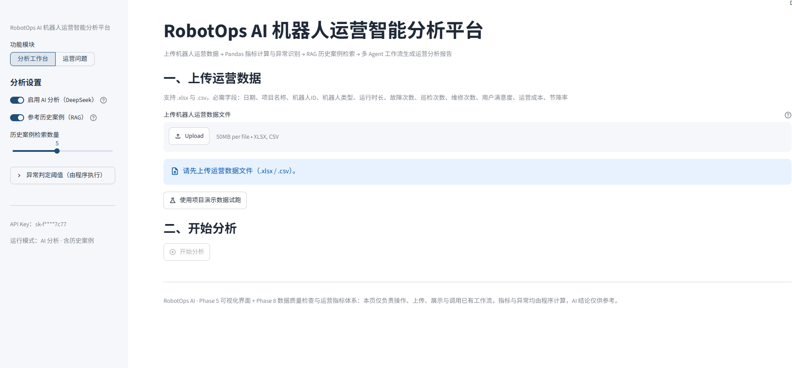
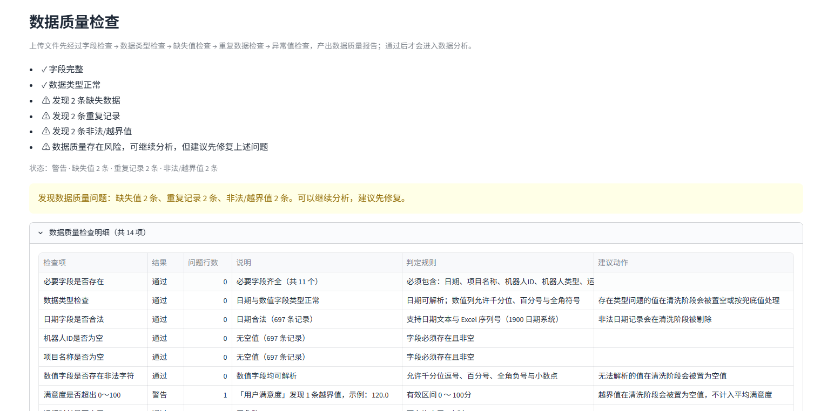

# RobotOps AI · 机器人运营智能分析平台

> **上传数据 → 指标 / 异常 → AI 解读 → 历史案例 → 整改建议 → 跟踪闭环**
>
> 一站式「机器人 / 设备运营」数据分析与问题管理平台。无需 LLM 也能跑通分析；
> 接入 DeepSeek 后自动获得诊断、建议与可解释的报告。

[](#12-环境要求)
[](#12-环境要求)
[](#17-测试方式)
[](LICENSE)

---

## 目录

1. [项目名称](#1-项目名称)
2. [项目背景](#2-项目背景)
3. [项目解决的问题](#3-项目解决的问题)
4. [核心功能](#4-核心功能)
5. [系统架构](#5-系统架构)
6. [Agent 工作流](#6-agent-工作流)
7. [RAG 架构](#7-rag-架构)
8. [数据指标体系](#8-数据指标体系)
9. [问题整改闭环](#9-问题整改闭环)
10. [技术栈](#10-技术栈)
11. [项目目录](#11-项目目录)
12. [环境要求](#12-环境要求)
13. [安装步骤](#13-安装步骤)
14. [环境变量配置](#14-环境变量配置)
15. [启动方式](#15-启动方式)
16. [Demo 使用流程](#16-demo-使用流程)
17. [测试方式](#17-测试方式)
18. [项目难点](#18-项目难点)
19. [关键技术设计](#19-关键技术设计)
20. [项目局限](#20-项目局限)
21. [后续规划](#21-后续规划)

附录：[截图说明](#附录截图说明) · [安全与合规](#附录安全与合规) · [FAQ](#附录faq)

---

## 1. 项目名称

**RobotOps AI · 机器人运营智能分析平台**

一个面向「机器人 / 智能设备运营」场景的数据分析与问题管理平台：把日常运营产生的 Excel / CSV 数据，自动变成可执行的运营建议和可跟踪的整改任务。

---

## 2. 项目背景

机器人（清洁 / 巡检 / 安防 / 配送 / 消杀 / AGV 搬运等）在园区、楼宇、港口等场景规模化部署后，运营团队每天都会面对：

- 大量分散在 Excel 里的运营明细（运行时长、故障、维修、满意度、成本等）；
- 异常发现滞后，往往等用户投诉或设备停机才被察觉；
- 老员工的排障经验随人员流动流失，新人重复踩坑；
- 异常只停留在报表里，没有责任人、没有整改验证，问题反复发生。

本项目把「数据分析 + AI 诊断 + 历史案例检索 + 工单闭环」串成一条可落地的链路，定位为**个人 / 小团队可离线运行的运营分析工具**，而非生产级 SaaS。

---

## 3. 项目解决的问题

| 痛点 | 本项目的应对 |
| --- | --- |
| 每天翻 Excel 找问题，效率低、易遗漏 | 程序自动计算 6 项核心指标 + 项目 / 机器人两个维度汇总 |
| 异常发现滞后 | 按阈值自动识别「故障率 / 满意度 / 运行率 / 节降率」4 类异常，并分级（高 / 中 / 低） |
| 现场工程师不会写分析报告 | DeepSeek 基于程序算出的结构化结果生成中文诊断与整改建议 |
| 老员工经验留不住 | RAG 检索本地历史案例库（17 篇 Markdown），给出可追溯的参考 |
| 异常没有闭环 | 「分析 → 创建问题 → 整改 → 重新上传数据 → 自动对比验证 → 关闭」工单闭环 |
| 非技术同事难以上手 | Streamlit 可视化界面，上传文件即可运行 |

---

## 4. 核心功能

- ✅ **零依赖即可用**：Phase 1 只需 pandas / numpy / openpyxl，无需任何 API Key
- ✅ **数据格式兼容**：Excel（xlsx / xlsm / xls）/ CSV；列名同义词别名自动映射（如「故障数」/「fault_count」）
- ✅ **4 条异常规则** + 严重程度分级（高 / 中 / 低），覆盖机器人运营最常见的 4 类痛点
- ✅ **数据质量检查**：重复行、重复上报、缺值、越界值、类型错误统一清洗并输出问题清单
- ✅ **DeepSeek 集成**：OpenAI 兼容接口，HTTP 用标准库 `urllib`，无三方 HTTP 依赖；指数退避重试
- ✅ **本地 RAG**：自研哈希 Embedding，**不下载任何预训练模型**，离线稳定运行
- ✅ **LangGraph 多 Agent 工作流**：Data Analysis → Abnormal Check → Diagnosis → RAG → Recommendation → Report
- ✅ **闭环工单**：异常 → 创建问题 → 整改 → 重新上传数据 → 自动对比验证 → 关闭（SQLite 持久化）
- ✅ **离线降级**：所有 AI 阶段都提供「不调用大模型」的确定性模板路径，便于本地调试与 CI
- ✅ **可追溯**：工作流状态（`workflow_state.json`）与步骤时间线（`workflow_steps.json`）可重放

---

## 5. 系统架构

### 5.1 总体架构（文本图）

```text
┌─────────────────────────────────────────────────────────────────────┐
│                              输入层                                  │
│   Excel/CSV 运营数据          knowledge/*.md 历史案例（17 篇）        │
└───────────────┬───────────────────────────────┬─────────────────────┘
                │                               │
                ▼                               ▼
┌───────────────────────────────┐   ┌───────────────────────────────────┐
│   Phase 1 · Pandas（确定性）    │   │   Phase 3 · RAG（本地向量库）       │
│  数据加载 → 清洗 → 指标 → 异常  │   │  文档切块 → 哈希 Embedding →        │
│  输出 AnalysisResult           │   │  ChromaDB 余弦检索                 │
└───────────────┬───────────────┘   └───────────────┬───────────────────┘
                │                                   │
                └───────────────┬───────────────────┘
                                ▼
┌─────────────────────────────────────────────────────────────────────┐
│                  Phase 4 · LangGraph 多 Agent 工作流                  │
│                                                                      │
│   Data Analysis → Abnormal Check ─┬─ 无异常 ─→ Report → END           │
│          （程序）      （程序判定）  │                                    │
│                                    └─ 有异常 ─→ Diagnosis → RAG →      │
│                                                  Recommendation →     │
│                                                  Report → END         │
│                  （Diagnosis / Recommendation / Report 可调用 LLM）     │
└───────────────────────────────┬─────────────────────────────────────┘
                                ▼
┌─────────────────────────────────────────────────────────────────────┐
│   Phase 5 · Streamlit UI          Phase 6 · 运营问题闭环（SQLite）      │
│   分析工作台 / 运营问题            发现 → 派单 → 处理 → 验证 → 关闭       │
└─────────────────────────────────────────────────────────────────────┘
```

### 5.2 核心流程图

```text
用户上传数据
    ↓
数据质量检查（缺值 / 越界 / 重复 / 类型）
    ↓
Pandas 数据分析（指标计算 + 趋势 + 项目对比）
    ↓
异常检测（4 条规则，程序判定，不调用 LLM）
    ↓
LangGraph 工作流编排
    ↓
Diagnosis Agent（LLM：原因解释）
    ↓
RAG Agent（检索历史案例）
    ↓
Recommendation Agent（LLM：整改建议）
    ↓
Report Agent（LLM：报告汇总 / 失败时程序模板兜底）
    ↓
运营问题（SQLite 工单）
    ↓
整改
    ↓
效果验证（重新上传数据，程序计算改善幅度）
    ↓
问题关闭
```

### 5.3 分层依赖约定

| 层 | 目录 | 依赖方向 |
| --- | --- | --- |
| 核心库 | `robotops/` | 禁止依赖 `app/` 或 `frontend/` |
| 工作流 | `app/` | 可依赖 `robotops/` |
| UI | `frontend/` | 可依赖 `robotops/` + `app/` |
| 脚本 | `scripts/` | 开发 / 调试用 |

---

## 6. Agent 工作流

### 6.1 工作流节点

```text
START
  → Data Analysis Agent（Phase 1 Pandas：指标 + 异常 + 趋势 + 项目对比）
  → Abnormal Check（程序判定，不调用 LLM）
      ├─ 无异常 → Report Agent → END
      └─ 有异常 → Diagnosis Agent → RAG Agent → Recommendation Agent → Report Agent → END
```

| Agent | 职责 | 是否调用 LLM |
| --- | --- | --- |
| Data Analysis Agent | 调用 Phase 1 流水线，产出结构化分析结果 | 否 |
| Abnormal Check | 读取 `anomaly_count`，决定是否进入诊断分支 | 否（程序判定） |
| Diagnosis Agent | 解释异常的可能原因（推测） | 是（失败时降级为确定性模板） |
| RAG Agent | 检索历史案例，保留来源与相似度 | 否 |
| Recommendation Agent | 综合数据 + 诊断 + 案例，生成整改建议 | 是（失败时降级为确定性模板） |
| Report Agent | 汇总全流程产出，生成最终报告 | 是（失败时降级为程序模板） |

### 6.2 任务分工：Python / LLM / RAG / LangGraph 各做什么

这是本项目最重要的边界设计：

| 类型 | 负责什么 | 说明 |
| --- | --- | --- |
| **Python（确定性）** | 数据加载、清洗、6 项核心指标计算、4 条异常规则判定、严重程度分级、趋势分析、项目横向对比、改善幅度计算 | 「是否异常」「指标是多少」全部由程序说了算，大模型不参与判断，也不参与计算 |
| **LLM（DeepSeek）** | 异常原因的自然语言解释、整改建议生成、最终报告的文字汇总 | 只接收程序算出的结构化「摘要 + 异常清单」，**不接收原始 Excel** |
| **RAG** | 针对异常描述检索本地历史案例库，为诊断与建议提供可追溯的参考 | 检索本身不调用 LLM；案例只作参考，引用时必须写明案例编号 |
| **LangGraph** | 负责 Agent 流程编排、状态传递、条件路由（有 / 无异常分支）、单节点失败不阻断、错误结构化记录 | 异常分支由程序结果（`state["has_anomalies"]`）驱动，大模型不参与路由决策 |

### 6.3 容错设计

- **单 Agent 失败不阻断**：失败原因写入 `state["errors"]`，其余 Agent 继续推进，最终报告降级生成。
- **LLM 失败自动跳过后续 LLM 节点**：前序大模型调用失败后，依赖 LLM 的 Agent 自动跳过，避免重复报错。
- **报告始终可产出**：Report Agent 在 LLM 不可用时改用程序模板，报告中明确标注降级原因。
- **离线模式**：`--no-llm` 全流程使用确定性模板，不消耗任何 LLM 额度。

---

## 7. RAG 架构

### 7.1 为什么不用 DeepSeek 做 Embedding

DeepSeek 开放平台只提供 Chat Completions（对话补全）接口，**没有 embedding 接口**，无法用它生成文本向量。因此本项目采用**本地哈希向量**方案。

### 7.2 本地哈希 Embedding

- 纯 Python + NumPy 实现，**不下载任何预训练模型**，离线稳定运行；
- 面向中文场景：同时使用「字符 2-gram / 3-gram」+「英文单词」+「领域词（故障 / 维修 / 满意度 / 节降 等 30+ 术语，权重更高）」三类特征；
- 通过 BLAKE2b 哈希映射到固定 1024 维并做 L2 归一化；
- **确定性**：同一段文本永远得到同一向量，便于索引重建与结果复现；
- 余弦相似度直接用于 ChromaDB 的 cosine 空间。

### 7.3 检索流程

```text
异常清单（程序产出）
    ↓
query_builder：按异常类型构造检索关键词
    ↓
相关性门控 + 分类优先检索（设备故障 / 维保 / 运营 / 满意度）
    ↓
相似度阈值过滤（默认 ≥ 0.35）
    ↓
Top-K 聚合（默认 5），最多注入提示词 6 个案例
    ↓
保留案例编号 / 标题 / 来源文件 / 相似度，供追溯
```

### 7.4 案例库组织

`knowledge/` 下 4 类共 17 篇 Markdown，每篇必须包含「问题 / 现象 / 可能原因 / 处理措施 / 处理结果」5 个段落：

| 分类 | 篇数 | 用途 |
| --- | --- | --- |
| `equipment_fault/` | 4 | 设备故障（电池 / 传感器 / 驱动 / 通讯） |
| `maintenance/` | 4 | 维保（计划保养 / 备件更换 / 巡检） |
| `operation/` | 5 | 运营（调度 / 路径 / 充电 / 排队） |
| `satisfaction/` | 4 | 满意度（投诉 / 噪音 / 响应） |

> 向量库持久化在 `data/chroma/`（已加入 `.gitignore`，可随时重建）。

---

## 8. 数据指标体系

### 8.1 原始数据列定义

| 列名（中文） | 类型 | 必填 | 说明 |
| --- | --- | --- | --- |
| 日期 | datetime | ✅ | 运营记录的日期 |
| 项目名称 | str | ✅ | 项目维度（去重计数 = 项目数量） |
| 机器人ID | str | ✅ | 设备维度（去重计数 = 机器人数量） |
| 机器人类型 | str | ✅ | 清洁 / 巡检 / 安防巡逻 / 配送 / 消杀 / AGV搬运 |
| 运行时长 | float | ✅ | 单位：小时 |
| 计划运行时长 | float | ❌ | 单位：小时；缺失时按类型兜底（详见 `config.PLANNED_HOURS_BY_TYPE`） |
| 故障次数 | int | ✅ | 累计故障次数 |
| 巡检次数 | int | ✅ | 累计巡检次数 |
| 维修次数 | int | ✅ | 累计维修次数 |
| 用户满意度 | float | ✅ | 0~100 分 |
| 运营成本 | float | ✅ | 单位：元 |
| 节降率 | float | ✅ | -100~100（%） |

> 列名同义词自动映射，详见 [config.py → COLUMN_ALIASES](robotops/config.py)。缺失必填列会给出明确提示。

### 8.2 指标口径

| 指标 | 口径 |
| --- | --- |
| 项目数量 | 对「项目名称」去重计数 |
| 机器人数量 | 对「机器人ID」去重计数 |
| 平均运行时长 | 清洗后记录的「运行时长」算术平均值（小时） |
| 故障率 | **总故障次数 / 总巡检次数 × 100%** |
| 平均满意度 | 有效「用户满意度」记录的算术平均值（分） |
| 总运营成本 | 有效「运营成本」记录的求和（元） |
| 平均节降率 | 有效「节降率」记录的算术平均值（%） |
| 运行率 | **运行时长 / 计划运行时长 × 100%**（派生列） |

> 均值与求和自动跳过空值（如满意度越界被置空的记录不会拉低平均值）。

### 8.3 异常识别规则

| 规则 | 默认阈值 | 判定粒度 |
| --- | --- | --- |
| 故障率 > 阈值 | 5.0% | 「机器人 + 分析周期」累计（默认）/ 可切换逐条 |
| 用户满意度 < 阈值 | 85.0 分 | 逐条记录 |
| 运行率 < 阈值 | 80.0% | 逐条记录 |
| 节降率 < 阈值 | 10.0% | 逐条记录 |

**严重程度分级**（偏差幅度 = |实际值 - 阈值| / |阈值|）：偏差 ≥ 50% → 高；≥ 20% → 中；其余 → 低。

> 故障率默认按周期累计判定，是因为单日样本过小会让阈值失去区分度（如 1 次故障 / 8 次巡检 = 12.5%）。可通过参数切换为逐条判定。

---

## 9. 问题整改闭环

发现 → 派单 → 处理 → 验证 → 关闭，指标数值与改善幅度**全部按实际数据计算**，不依赖大模型推断。

### 9.1 状态机

```text
[创建] → 待处理
待处理 → 处理中（开始处理）
待处理 → 已关闭（误报直接关闭）
处理中 → 待验证（提交整改）
处理中 → 待处理（回退）
处理中 → 已关闭（撤单）
待验证 → 已完成（验证通过）
待验证 → 处理中（验证不通过）
已完成 → 已关闭（归档）
已完成 → 待验证（重新打开）
已关闭 → 处理中（重新打开）
```

- **问题编号格式**：`ISSUE-YYYYMM-NNN`（如 `ISSUE-202609-001`）
- **持久化**：SQLite（WAL 模式），默认 `data/issues.db`，可通过环境变量 `ROBOTOPS_ISSUES_DB` 覆盖路径。

### 9.2 整改效果验证（无需 LLM）

1. 用户重新上传整改后的数据 → Phase 1 算出新指标；
2. `compute_metric_change` 按 `|改后 - 改前| / |改前|` 计算改善幅度；
3. 改善幅度 ≥ 10% → 「明显改善」；< 10% → 「轻微改善」；无改善 → 验证未通过，回退到处理中。

---

## 10. 技术栈

| 类别 | 选型 | 说明 |
| --- | --- | --- |
| 语言 | Python 3.10+ | 已在 Python 3.12 验证 |
| 数据处理 | pandas / numpy / openpyxl | Phase 1 核心，Excel/CSV 读写与指标计算 |
| 向量数据库 | ChromaDB | 本地持久化，余弦相似度检索 |
| Embedding | 自研本地哈希（BLAKE2b + n-gram，1024 维） | 不下载预训练模型，离线可用 |
| 工作流编排 | LangGraph | 多 Agent 状态图编排与条件路由 |
| LLM | DeepSeek（OpenAI 兼容接口） | HTTP 用标准库 `urllib`，无三方 HTTP 依赖 |
| 前端 | Streamlit | 单入口 + 侧边栏切换两个视图模块 |
| 持久化 | SQLite（WAL 模式） | 运营问题工单存储 |
| 测试 | pytest | 417 个用例 + 169 子测试 |

> 完整依赖见 [requirements.txt](requirements.txt)。

---

## 11. 项目目录

```text
RobotOps AI/
├── main.py                 # Phase 2 CLI 入口（Pandas + DeepSeek Agent）
├── run_analysis.py         # Phase 1 CLI 入口（纯 Pandas 分析）
├── run_workflow.py         # Phase 4 CLI 入口（LangGraph 多 Agent 工作流）
├── requirements.txt        # 运行依赖
├── requirements-dev.txt    # 测试依赖（pytest）
├── pytest.ini              # 测试配置
├── .env.example            # 环境变量示例
├── LICENSE                 # MIT
│
├── robotops/               # 核心库（Phase 1~3 + 6，不依赖 app/ 与 frontend/）
│   ├── config.py           # 路径、列定义、阈值（唯一来源）
│   ├── data_loader.py      # 读取 Excel/CSV + 列名别名映射
│   ├── data_cleaner.py     # 缺值/类型/边界/重复清洗
│   ├── metrics.py          # 6 项核心指标 + 项目汇总
│   ├── anomaly.py          # 4 条异常规则 + 严重程度分级
│   ├── trends.py           # 趋势分析（程序计算）
│   ├── comparison.py       # 项目横向对比（程序计算）
│   ├── quality.py          # 数据质量检查
│   ├── indicators.py       # 指标定义表
│   ├── pipeline.py         # 完整流水线（读取→清洗→指标→异常→导出）
│   ├── report.py           # 报告导出（Excel/CSV/JSON/Markdown）
│   ├── cli.py              # Phase 1 CLI
│   ├── llm/                # Phase 2 · DeepSeek 客户端 / 配置 / Schema / Prompt
│   ├── rag/                # Phase 3 · RAG（ChromaDB + 哈希 Embedding + 检索）
│   ├── agent/              # Phase 2 · Agent 编排 + 载荷构造
│   └── issues/             # Phase 6 · 运营问题（SQLite + 业务逻辑）
│
├── app/                    # Phase 4 · 多 Agent 工作流（LangGraph）
│   ├── agents/             # data_analysis / diagnosis / rag_agent / recommendation / report
│   └── graph/              # 工作流编排（workflow.py）+ 状态（state.py）+ 日志 + Prompt
│
├── frontend/               # Phase 5 · Streamlit 可视化
│   ├── app.py              # 平台入口（侧边栏切换模块）
│   ├── ui_helpers.py       # 上传 / 预览 / 状态辅助
│   ├── quality_helpers.py  # 数据质量展示
│   ├── trend_helpers.py    # 趋势展示
│   ├── issues_helpers.py   # 问题工单辅助
│   ├── evidence_helpers.py # 分析依据展示
│   └── views/              # analysis.py（分析工作台）/ issues.py（运营问题）
│
├── tests/                  # 37 个测试文件（417 用例 + 169 子测试）
├── scripts/                # 演示数据生成 / 知识库构建 / API 自检 / 冒烟测试
│
├── knowledge/              # Phase 3 · 案例库（4 类 17 篇 Markdown）
│   ├── equipment_fault/    #   设备故障 4 篇
│   ├── maintenance/        #   维保 4 篇
│   ├── operation/          #   运营 5 篇
│   └── satisfaction/       #   满意度 4 篇
│
├── data/
│   ├── raw/                # 原始数据（含 robot_operation_demo.xlsx）
│   ├── processed/          # 清洗后数据
│   └── chroma/             # ChromaDB 索引（可重建，已 gitignore）
│
├── docs/images/            # 截图存放位置（预留）
│
└── output/                 # 默认输出目录（报告 / 工作流产物 / 日志）
```

---

## 12. 环境要求

- Python 3.10 及以上（开发与验证环境：Python 3.12）
- 操作系统：Windows / macOS / Linux
- 磁盘：约 500MB（含 ChromaDB / Streamlit / LangGraph 依赖）
- 可选：DeepSeek API Key（不配置也可完整跑通离线分析与离线工作流）

---

## 13. 安装步骤

```bash
git clone <your-repo-url> robotops-ai
cd robotops-ai

python -m venv .venv
# Windows
.venv\Scripts\activate
# macOS / Linux
source .venv/bin/activate

python -m pip install -r requirements.txt
```

> Phase 1 只需 pandas / numpy / openpyxl 即可运行；安装完整依赖后可使用 RAG、工作流与可视化界面。

---

## 14. 环境变量配置

复制示例文件并填入密钥：

```bash
cp .env.example .env
# 编辑 .env，把 DEEPSEEK_API_KEY=sk-xxx 替换为真实密钥
```

### 必填项

| 变量 | 说明 |
| --- | --- |
| `DEEPSEEK_API_KEY` | DeepSeek API Key，从 [platform.deepseek.com](https://platform.deepseek.com/) 获取 |

> `.env` 已被 `.gitignore` 忽略，**严禁**把真实密钥提交到 Git。代码中无任何硬编码密钥。

### 可选项（均有默认值，详见 [.env.example](.env.example)）

| 分组 | 变量 | 默认值 |
| --- | --- | --- |
| DeepSeek | `DEEPSEEK_BASE_URL` | `https://api.deepseek.com` |
| | `DEEPSEEK_MODEL` | `deepseek-chat` |
| | `DEEPSEEK_TIMEOUT` | `60`（秒） |
| | `DEEPSEEK_MAX_RETRIES` | `2` |
| | `DEEPSEEK_TEMPERATURE` | `0.2` |
| | `DEEPSEEK_MAX_TOKENS` | `4096` |
| | `DEEPSEEK_LOG_LEVEL` | `INFO` |
| RAG | `ROBOTOPS_KNOWLEDGE_DIR` | `knowledge` |
| | `ROBOTOPS_CHROMA_DIR` | `data/chroma` |
| | `ROBOTOPS_RAG_TOP_K` | `5` |
| | `ROBOTOPS_RAG_MAX_CASES` | `6` |
| | `ROBOTOPS_RAG_MIN_SIMILARITY` | `0.35` |
| | `ROBOTOPS_EMBEDDING_BACKEND` | `local_hashing`（固定） |
| Issues | `ROBOTOPS_ISSUES_DB` | `data/issues.db` |

### 阈值调整

两种方式：

1. **命令行参数**（单次生效）：`python run_analysis.py --fault-rate-upper 4.5 --satisfaction-lower 88`
2. **改代码默认值**（永久生效）：编辑 [config.py → AnomalyThresholds](robotops/config.py)

---

## 15. 启动方式

### 15.1 命令行

| 命令 | 说明 |
| --- | --- |
| `python run_analysis.py` | Phase 1：Pandas 分析 + 报告导出（无需 API Key） |
| `python main.py` | Phase 1 + 2：Pandas + DeepSeek 分析 |
| `python main.py --dry-run` | 只打印「将发给大模型」的结构化载荷，不调用 API |
| `python main.py --search "巡检机器人漏检怎么处理"` | 仅检索知识库 Top-K 案例 |
| `python main.py --rebuild-knowledge` | 重建 RAG 知识库索引 |
| `python run_workflow.py` | Phase 4：LangGraph 多 Agent 工作流 |
| `python run_workflow.py --no-llm` | 离线模板模式（不调用 LLM） |
| `python run_workflow.py --no-rag` | 关闭 RAG 检索 |
| `python run_workflow.py --json` | 以 JSON 输出工作流状态 |

**常用参数**（Phase 1/2/4 均支持）：

| 参数 | 默认值 | 说明 |
| --- | --- | --- |
| `-d / --data PATH` | 演示数据 | 数据文件路径 |
| `-o / --output DIR` | `output/` | 结果输出目录 |
| `--sheet NAME` | 第一个 sheet | Excel 工作表 |
| `--encoding ENC` | 自动识别 | CSV 编码（如 `gbk`） |
| `--fault-rate-upper PCT` | `5.0` | 故障率上限阈值 |
| `--satisfaction-lower SCORE` | `85.0` | 满意度下限阈值 |
| `--uptime-rate-lower PCT` | `80.0` | 运行率下限阈值 |
| `--saving-rate-lower PCT` | `10.0` | 节降率下限阈值 |
| `--rag-top-k N` | `5` | RAG 检索 Top-K |
| `--rag-min-similarity F` | `0.35` | RAG 最低相似度阈值 |
| `--rag-max-cases N` | `6` | 最多注入提示词的案例数 |

### 15.2 可视化界面（Streamlit）

```bash
streamlit run frontend/app.py
# 浏览器打开 http://localhost:8501
```

界面包含两个模块（侧边栏切换）：

- **分析工作台**：上传 Excel / CSV → 调阈值 → 启用 / 关闭 AI → 运行分析 → 创建运营问题
- **运营问题**：问题列表 / 详情 / 处理记录 / 状态流转 / 整改效果验证 / 关闭

> Windows 下如遇页面乱码，先执行：`$env:PYTHONIOENCODING="utf-8"`（PowerShell）。

### 15.3 Python API

```python
from robotops.pipeline import run_analysis
from robotops.config import AnomalyThresholds

# Phase 1：纯 Pandas 分析
result = run_analysis(
    data_path="data/raw/robot_operation_demo.xlsx",
    output_dir="output/",
    thresholds=AnomalyThresholds(fault_rate_upper=4.5, satisfaction_lower=88.0),
)
print(result.metrics_dict())
print(f"异常 {result.anomaly_count} 条")
```

---

## 16. Demo 使用流程

仓库已内置演示数据 [data/raw/robot_operation_demo.xlsx](data/raw/robot_operation_demo.xlsx)，无需自备数据即可完整触发全链路。

### 16.1 Demo 数据说明

由 [scripts/generate_demo_data.py](scripts/generate_demo_data.py) 生成：

- **规模**：6 个项目 / 23 台机器人 / 30 天 ≈ 690 条正常记录 + 7 条注入的「脏数据」（用于验证清洗逻辑）；
- **4 个工作表**：运营数据（主表）/ 字段说明 / 项目与机器人清单 / 数据说明（脏数据清单与预期清洗动作）；
- **刻意制造的异常**（覆盖全部 4 类规则）：

| 异常类型 | 演示对象 |
| --- | --- |
| ① 故障率异常 | 天津港巡检项目 TJ-INS-05（周期累计故障率远超阈值）、深圳安防 SZ-SEC-03、成都配送 CD-DLV-02 |
| ② 满意度下降 | 苏州清洁 SZ-CLN-04、成都配送 CD-DLV-01 |
| ③ 成本上涨 / 节降率下降 | 武汉消杀项目整体（WH-DIS-01/02/03 节降率低于阈值，单位成本偏高） |
| ④ 运行率下降 | 深圳安防 SZ-SEC-02（运行率低于阈值） |

> 「成本上涨」通过节降率偏低与项目横向对比体现：演示数据中无独立的「成本上涨」异常规则，成本相关结论由节降率指标 + 项目对比 + LLM 综合得出。

### 16.2 完整流程演示

```bash
# 1) 离线分析（无需 API Key）—— 触发：数据质量检查 → 指标 → 异常 → 报告
python run_analysis.py

# 2) 多 Agent 工作流（离线模式）—— 触发：数据分析 → 异常检测 → RAG → Agent → 报告
python run_workflow.py --no-llm

# 3) 启用 AI（需配置 DEEPSEEK_API_KEY）—— Diagnosis / Recommendation / Report 调用 LLM
python run_workflow.py

# 4) 可视化界面
streamlit run frontend/app.py
#    上传 robot_operation_demo.xlsx → 运行分析 → 在「运营问题」模块创建工单并走闭环
```

运行后在 `output/` 查看产物：

| 文件 | 内容 |
| --- | --- |
| `robot_ops_report.xlsx` / `.md` | Phase 1 主报告（指标 / 项目汇总 / 异常清单 / 清洗问题） |
| `robot_ops_report_anomalies.csv` | 异常清单（含严重程度） |
| `workflow_report.md` | Phase 4 多 Agent 工作流最终报告 |
| `workflow_state.json` | 工作流完整状态（可重放） |
| `workflow_steps.json` | 各阶段时间线 |

---

## 17. 测试方式

```bash
# 安装测试依赖（如尚未安装）
python -m pip install -r requirements-dev.txt

# 跑全部测试
python -m pytest tests/ -v

# 单文件
python -m pytest tests/test_pipeline.py -v

# 按名称过滤
python -m pytest tests/ -k "anomaly or cleaner"
```

**当前测试结果**：`417 passed, 169 subtests passed`（Python 3.12，Windows）。

**测试覆盖**（37 个测试文件）：

| 模块 | 测试文件 |
| --- | --- |
| 数据加载 / 清洗 / 质量 | `test_data_loader.py` / `test_data_cleaner.py` / `test_data_quality.py` / `test_quality.py` |
| 指标 / 异常 / 趋势 / 对比 | `test_metrics.py` / `test_anomaly.py` / `test_trends.py` / `test_comparison.py` / `test_indicators.py` |
| 流水线 / 报告 | `test_pipeline.py` / `test_data.py` / `test_evidence.py` |
| DeepSeek 客户端 / 配置 / Schema | `test_deepseek_client.py` / `test_llm_config.py` / `test_ai_schema.py` / `test_env_loader.py` |
| Agent / 载荷 / 错误处理 | `test_agent.py` / `test_agent_payload.py` / `test_error_handling.py` / `test_logger.py` |
| RAG | `test_rag.py` / `test_rag_document_loader.py` / `test_rag_embedding.py` / `test_rag_retriever.py` / `test_rag_agent.py` / `test_rag_traceability.py` |
| 工作流 / CLI | `test_workflow.py` / `test_workflow_cli.py` / `test_main_cli.py` |
| 前端 | `test_frontend_app.py` / `test_frontend_helpers.py` / `test_frontend_quality.py` / `test_frontend_trends.py` / `test_frontend_evidence.py` / `test_issues_page.py` |
| 运营问题 | `test_issues.py` / `test_issue.py` |

> 所有阶段均提供「离线 / 干跑」路径，CI 运行不消耗任何 LLM 额度。

---

## 18. 项目难点

1. **指标与异常的「确定性边界」**：故障率是比率型指标，单日样本过小会让阈值失效（1 次故障 / 8 次巡检 = 12.5%）。解决：故障率默认按「机器人 + 分析周期」累计判定，其他指标按逐条记录判定，并通过参数可切换。
2. **LLM 幻觉与可信度**：直接让大模型读 Excel 会产生虚构数字。解决：程序先算出结构化摘要，大模型只做「解释与建议」，不做「计算与判定」；模型返回的每条结论要求附 evidence，缺失时用程序事实兜底。
3. **Embedding 方案**：DeepSeek 没有 embedding 接口，引入第三方模型会增加依赖与离线成本。解决：自研基于 BLAKE2b 的本地哈希向量（字符 n-gram + 领域词加权），确定性、零依赖、可复现。
4. **多 Agent 工作流的容错**：任一 Agent 失败不应导致整体不可用。解决：BaseAgent 模板方法统一捕获异常并结构化记录到 `state["errors"]`；单节点失败不阻断，LLM 失败后自动跳过后续 LLM 节点，报告始终由程序模板兜底产出。
5. **Streamlit 多页路由的控件重复问题**：`st.navigation` 在无头测试环境会重复执行页面脚本。解决：采用「单入口 + 侧边栏切换 + `runpy` 执行单个视图脚本」的方案，保证每次 rerun 只执行一个模块。
6. **整改效果的客观验证**：不能让大模型判断「整改是否有效」。解决：用户重新上传数据后，程序按 `|改后 - 改前| / |改前|` 计算改善幅度，按 10% 阈值分级，全程无 LLM 参与。

---

## 19. 关键技术设计

> 面试重点说明。

### 19.1 为什么不用 LLM 直接计算数据

- LLM 做数值计算不可靠，会产生**幻觉数字**（四舍五入错误、漏算、虚构记录）；
- 计算逻辑应由可测试、可复现的代码承担；
- 本项目的分工是：**Python 算指标、判异常；LLM 只负责自然语言的解释、建议与报告撰写**。发给大模型的是程序算出的「指标摘要 + 异常清单」，原始 Excel 不离开本机。

### 19.2 为什么需要 RAG

- 运营排障高度依赖**历史经验**，而通用大模型缺乏企业内部的案例知识；
- RAG 把本地 17 篇历史案例（设备故障 / 维保 / 运营 / 满意度）检索出来作为参考，让建议**有出处、可追溯**；
- 案例只作参考，Prompt 中明确要求引用时写明案例编号，不得把案例数据当作当前项目事实。

### 19.3 为什么使用 LangGraph

- 工作流存在**条件分支**（有异常走诊断全流程，无异常直接出报告），普通线性链无法表达；
- 需要在节点间传递**结构化状态**（指标 / 异常 / 案例 / 建议），并保留每步的时间线与错误记录；
- 需要**单节点失败不阻断**的容错能力；LangGraph 的 StateGraph + 条件路由天然适合这类多 Agent 编排。

### 19.4 如何处理 Agent 幻觉

- **职责分离**：计算与判定归程序，LLM 只做解释；
- **Prompt 约束**：要求模型返回结构化 JSON，每条结论附 `evidence`（分析依据）；
- **evidence 兜底**：模型未返回 evidence 时，用程序计算的事实（当前指标 / 程序判定 / 趋势 / 对比 / 案例）补齐；
- **标注来源**：诊断与建议结果中记录 `source`（`llm` / `offline_template`）、模型名、生成时间，离线模板明确标注「未调用大模型」。

### 19.5 如何处理 API 失败

- DeepSeek 客户端实现**指数退避重试**（限流 / 服务端错误 / 超时 / 网络错误）；
- 单次 Agent 失败被捕获并结构化记录到 `state["errors"]`，**不阻断**后续节点；
- 前序 LLM 失败后，依赖 LLM 的 Agent **自动跳过**，避免重复报错；
- Report Agent 在 LLM 不可用时**改用程序模板**生成报告，报告中明确标注降级原因；
- 全流程支持 `--no-llm` 离线模式，CI / 调试零成本。

### 19.6 如何保证数据可追溯

- 工作流完整状态导出为 `workflow_state.json`，步骤时间线导出为 `workflow_steps.json`，**可重放**；
- 发给大模型的载荷导出为 `ai_input_payload.json`，RAG 检索结果导出为 `ai_rag_retrieval.json`（含案例来源与相似度）；
- 每条异常、每条建议都保留 `evidence`（程序事实或案例编号）；
- 运营问题存 SQLite（WAL 模式），含完整状态流转记录。

### 19.7 如何实现问题整改闭环

- 异常 → 一键创建运营问题（`ISSUE-YYYYMM-NNN`），状态机覆盖「待处理 / 处理中 / 待验证 / 已完成 / 已关闭」；
- 整改后**重新上传数据**，程序用 `|改后 - 改前| / |改前|` 计算改善幅度（≥10% 明显改善 / <10% 轻微改善 / 无变化则验证不通过回退）；
- 验证通过 → 已完成 → 归档关闭；全程**不依赖 LLM 判断效果**，指标数值全部按实际数据计算。

---

## 20. 项目局限

> 以下为当前真实存在的局限，不做夸大。

1. **Embedding 为本地哈希方案**：相比预训练模型，语义理解能力有限，检索质量依赖案例文本与异常描述的字面重合度；不下载模型换来的是零依赖与离线可用。
2. **案例库规模小**：仅 17 篇手写 Markdown 案例，覆盖面有限；RAG 命中效果随案例库扩充而提升。
3. **LLM 仅适配 DeepSeek**：HTTP 客户端按 OpenAI 兼容接口实现，未抽象多模型适配层；接入其他模型需改 `robotops/llm/client.py`。
4. **单用户本地工具**：无多租户、无权限管理、无并发控制；运营问题库为本地 SQLite，不适合多用户同时写入。
5. **未做生产部署**：Streamlit 为开发服务器，未配置反向代理 / 进程守护 / 容器化；README 不描述未实现的部署能力。
6. **异常规则为阈值型**：未引入统计过程控制（SPC）或机器学习预测，异常判定完全依赖人工设定的阈值。
7. **演示数据为模拟生成**：用于功能验证，不代表任何真实项目的运营水平；README 中不虚构准确率、用户规模等指标。

---

## 21. 后续规划

| 优先级 | 方向 | 说明 |
| --- | --- | --- |
| 🔜 | 多项目横向基准（Benchmark） | 在项目对比基础上引入行业基线，自动标注「显著优于 / 劣于同行」 |
| 🔜 | 定时分析 | 定时任务 + 邮件 / 消息推送 |
| 💡 | 多模型适配 | 抽象 LLM 客户端接口，支持 OpenAI / 国产模型切换 |
| 💡 | 更强的 Embedding | 可选接入 sentence-transformers 等本地模型，与哈希方案并存 |
| 💡 | 案例库扩充工具 | 半结构化录入界面，降低新增案例的门槛 |
| 💡 | 统计型异常检测 | 在阈值规则之外补充 SPC / 同比环比检测 |

> 以上为规划方向，当前版本未实现。

---

## 附录：截图说明

> 当前环境未自动截图。建议运行 `streamlit run frontend/app.py` 后，按下表在浏览器中截图，保存到 `docs/images/` 目录，再取消对应注释。

| # | 截图位置 | 建议文件名 |
| --- | --- | --- |
| 1 | 首页 / 分析工作台初始页 | `docs/images/01_home.png` |
| 2 | 数据质量检查结果（清洗问题清单） | `docs/images/02_data_quality.png` |
| 3 | 运营指标（6 项核心指标 + 项目汇总） | `docs/images/03_metrics.png` |
| 4 | 异常项目清单（含严重程度） | `docs/images/04_anomalies.png` |
| 5 | RAG 历史案例检索结果 | `docs/images/05_rag_cases.png` |
| 6 | AI 分析（诊断 + 建议 + 分析依据） | `docs/images/06_ai_analysis.png` |
| 7 | 运营问题列表 | `docs/images/07_issues_list.png` |
| 8 | 整改验证（改善幅度计算与状态流转） | `docs/images/08_verification.png` |

<!--
在 README 中插入截图的示例（取消注释并替换文件名）：





-->

---

## 附录：安全与合规

- **密钥管理**：API Key 仅通过 `.env` 注入，代码中无任何硬编码密钥；`.env` 已加入 `.gitignore`
- **本地优先**：所有数据（向量库 / SQLite / 输出文件）均存储在本地，无外部服务依赖
- **隐私保护**：发给大模型的只是「指标 + 异常摘要」，原始 Excel 不会离开本机
- **可审计**：工作流产物（`workflow_state.json` / `workflow_steps.json`）可重放，方便审计
- **可控**：任何 AI 阶段都可降级为离线模式，CI / 测试环境零成本

---

## 附录：FAQ

<details>
<summary><b>Q：没有 DeepSeek API Key 能跑吗？</b></summary>

可以。

- `python run_analysis.py`：纯 Pandas，无 LLM
- `python run_workflow.py --no-llm`：多 Agent 离线模板
- `python main.py --dry-run`：打印将发送给大模型的载荷，无需 Key
- Streamlit 界面：未配置 Key 时自动使用离线模板
</details>

<details>
<summary><b>Q：原始数据没有「计划运行时长」怎么办？</b></summary>

会按 `DEFAULT_PLANNED_HOURS = 24.0` 兜底（每机器人类型有预设值，详见 `config.PLANNED_HOURS_BY_TYPE`）。如需自定义，直接在数据里加一列即可。
</details>

<details>
<summary><b>Q：知识库可以扩展吗？</b></summary>

可以。在 `knowledge/<分类>/` 下新增 `CASE-XXX-NNN.md`，文件包含「问题 / 现象 / 可能原因 / 处理措施 / 处理结果」5 个段落即可。然后运行 `python main.py --rebuild-knowledge` 重建索引。
</details>

<details>
<summary><b>Q：运营问题数据存在哪？</b></summary>

SQLite 数据库，默认 `data/issues.db`（WAL 模式）。可通过环境变量 `ROBOTOPS_ISSUES_DB` 覆盖路径。该文件已在 `.gitignore` 中，可随时删除重建。
</details>

---

## 许可证

[MIT](LICENSE) © 2026 RobotOps AI Contributors
